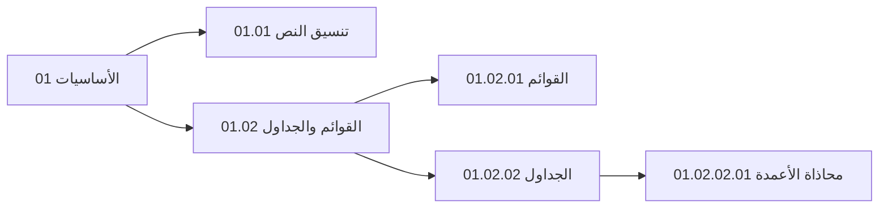

## نبذة عن هذا الفصل

مرحبًا بك في الفصل الأول. هنا نتعلم **اللبنات الأساسية** التي يُبنى عليها كل ما بعدها: النص، والقوائم، والجداول.

هذا الكتاب مكتوب بالكامل بصيغة Markdown، وكل صفحة فيه ملف مستقل. ترقيم العنوان الذي تراه أعلاه (`01`) يُستخرج تلقائيًا من اسم الملف، ومستوى العنوان (`h2`) يُحدَّد من عمق الملف في المجلدات.

> [!TIP]
> بعد كل صفحة اختبار قصير. حقّق **٨٠٪** وسيُضاء زر «التالي»، أو تخطَّ الاختبار إن شئت.

---

## خريطة مسار الفصل

---

## أقسام الفصل ومحتوياته

يتفرع هذا الفصل إلى الأقسام التالية:
- **‎01.01 تنسيق النص:** أساليب التأكيد، الخط الغامق والمائل، الحواشي السفلية، والرموز.
- **‎01.02 القوائم والجداول:** القوائم النقطية والمرقمة، قوائم المهام التفاعلية، والجداول مع محاذاة الأعمدة.
