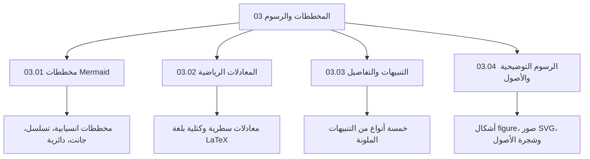

الكتب الرقمية الحديثة لا تقتصر على النصوص الساكنة؛ بل تحتاج إلى أدوات بصرية غنية تشرح الأفكار المعقدة بدقة وانسيابية.

في هذا الفصل، نستعرض أربع قدرات بصرية استثنائية يدعمها القالب بشكل أصيل:

تتميز هذه العناصر بأنها تُكتب كـ **نصوص صريحة (Plain Text)** داخل ملفات Markdown، مما يتيح تتبع تعديلاتها عبر أنظمة التحكم بالإصدارات Git، وتكيّفها التلقائي مع الوضع الليلي (Dark Theme).
