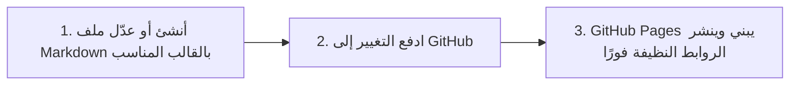

صُمم هذا القالب ليكون **أسهل طريقة لنشر كتاب إلكتروني عربي تفاعلي** على الإطلاق؛ فلا حاجة لتثبيت حزم معقدة، ولا أدوات تجميع أو برمجيات بناء على جهازك المحلي.

---

### دورة التأليف والنشر في ٣ خطوات

1. **أنشئ ملفك المرقّم أو اختر قالبه:** ضع الملف في المسار المناسب مع بادئة رقمية من خانتين (أو داخل مجلد `_book/` كـ Collection)، وحدد قالبه المناسب (`chapter` أو `section` أو `subsection` أو `frontmatter` أو `backmatter` أو `mcq`).
2. **اكتب المحتوى وترويسة الأسئلة:** حدد `title` و `slug` و `permalink` وأسئلة `quiz` الاختيارية في بداية الملف.
3. **ادفع التغيير عبر Git:** ادفع إلى فرع `main`، فيقوم GitHub Pages بنشر النسخة المحدثة فورًا بروابط نظيفة وبصمة رقمية موثقة.

---

### أقسام دليل التأليف

انتقل إلى الأقسام التالية للتعرف على التفاصيل العملية:
- **‎04.01 الترقيم والبنية:** قواعد تسمية المجلدات، والمستويات الستة، والروابط النظيفة، ومسار التصفح (Breadcrumbs).
- **‎04.02 كتابة الاختبارات:** دليل أنواع الأسئلة الخمسة مع أمثلة عملية قابلة للنسخ.
- **‎04.03 قوالب الثيم والمعمارية القياسية:** تفصيل القوالب الأربعة عشر، والمكونات الجزئية، والربط بـ `post_url`، والتحقق عبر SHA-256.

