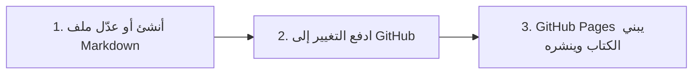

صُمم هذا القالب ليكون **أسهل طريقة لنشر كتاب إلكتروني عربي تفاعلي** على الإطلاق؛ فلا حاجة لتثبيت حزم معقدة، ولا أدوات تجميع أو برمجيات بناء على جهازك المحلي.

---

### دورة التأليف والنشر في ٣ خطوات

1. **أنشئ ملفك المرقّم:** ضع الملف في المسار المناسب مع بادئة رقمية من خانتين (مثل `05_typography/01_tashkeel.md`).
2. **اكتب المحتوى وترويسة الأسئلة:** حدد `title` وأسئلة `quiz` الاختيارية في بداية الملف.
3. **ادفع التغيير عبر Git:** ادفع إلى فرع `main`، فيقوم GitHub Pages بنشر النسخة المحدثة فورًا خلال ثوانٍ معدودة.

انتقل إلى القسمين التاليين للتعرف على:
- **‎04.01 الترقيم والبنية:** قواعد تسمية المجلدات وتوليد العناوين الهرمية.
- **‎04.02 كتابة الاختبارات:** دليل أنواع الأسئلة الخمسة مع أمثلة عملية قابلة للنسخ.
