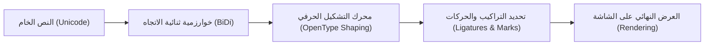

تُعدّ **الطباعة العربية الرقمية (Arabic Web Typography)** واحدة من أثرى وأدق مجالات التصميم على شبكة الويب؛ فاللغة العربية ليست مجرد أبجدية تُكتب من اليمين إلى اليسار (RTL)، بل هي نظام كتابي متصل وحيوي يتميز بنسب بصرية دقيقة، وحركات تشكيلية متعددة الطبقات، وتراكيب حرفية (Ligatures) أصيلة.

يهدف هذا الفصل إلى **اختبار كافة إمكانات وقدرات القالب** في معالجة أدق تفاصيل الحرف العربي ونصوصه، وضمان تجربة قراءة مريحة ومتسقة عبر مختلف الأجهزة والأنظمة والوضعيتين (النهارية والليلية).

---

## كيف يعالج المتصفح النصوص العربية؟

يمر النص العربي في المتصفح بعدة مراحل تقنية حتى يظهر بالشكل المطلوب:

---

## خريطة هذا الفصل

يتفرع من هذا الفصل أربعة أقسام اختبارية متخصصة:

1. **‎05.01 التشكيل والحركات والرموز:** اختبار الحركات الإعرابية، تراكيب الشدة والتنوين، الآيات، والنصوص المشكولة بالكامل.
2. **‎05.02 النصوص ثنائية الاتجاه والأرقام:** اختبار تداخل الكلمات اللاتينية وسط العربية، والأرقام المشرقية والمغربية، والرموز التقنية.
3. **‎05.03 الخطوط والأوزان والشعر العربي:** مقارنة الأوزان من 300 إلى 800، والكشيدة، وتنضيد شطري الشعر العربي المتوازي.
4. **‎05.04 الحواشي وعلامات الترقيم:** اختبار الحواشي السفلية، علامات الترقيم الدقيقة، وقوائم المصطلحات والتعريفات.
