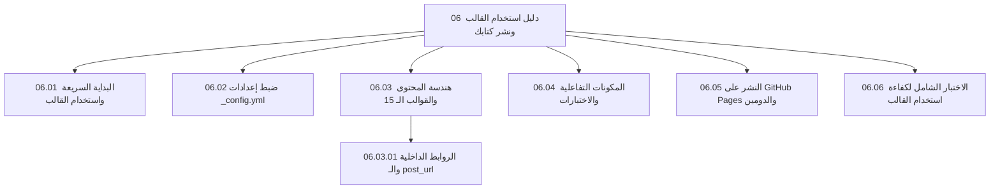

## مرحبًا بك في الدليل الإرشادي الشامل للقالب

صُمم هذا الفصل ليكون **مرجعًا ودليلًا تعليميًا تفاعليًا (Step-by-step Tutorial)** موجّهًا للمؤلفين، والمترجمين، والناشرين، ومطوري الويب الذين يرغبون في استخدام هذا القالب لإنتاج ونشر كتبهم الرقمية التفاعلية على منصة **GitHub Pages**.

<figure style="margin: 2rem auto; text-align: center; max-width: 680px;">
  
  <figcaption style="margin-top: 0.8rem; font-size: 0.95rem; color: var(--muted); font-family: 'Noto Naskh Arabic', sans-serif;">
    <strong>شكل (٦ - ١):</strong> دورة العمل المبسطة من استنساخ القالب حتى النشر التلقائي المباشر.
  </figcaption>
</figure>

---

## خريطة مسار هذا الفصل التعليمي

---

## ماذا ستتعلم في هذا الفصل؟

1. **البداية السريعة كقالب مستودع:** كيفية إنشاء مستودع جديد لكتابك بنقرة زر واحدة عبر خيار `Use this template` على GitHub.
2. **تخصيص الهوية والإعدادات:** تعبئة عنوان كتابك، المعرفات الدولية (ISBN و DOI)، بيانات وسيرة المؤلف، وشبكات التواصل، وضبط مصفوفة المساهمين الخمسة لصون الحقوق الفكرية.
3. **هيكلة الفصول والأقسام:** استخدام المستويات الستة الهرمية، واختيار القالب المناسب لكل مستوى، وإدارة المواد الافتتاحية (Front Matter) والختامية (Back Matter).
4. **الربط الداخلي والتنقل:** استخدام وسوم الربط بالمنشورات المؤرخة `post_url`، والربط بالملفات `link`، والروابط النظيفة.
5. **المكونات التفاعلية والاختبارات:** تضمين أسئلة الفهم الذاتي (MCQ)، وشريط تقدم القراءة، والفهرس الجانبي المطوي، والبصمة الرقمية المشفرة.
6. **النشر التلقائي والدومين المخصص:** تفعيل خدمة GitHub Pages وضبط الرابط المخصص أو النطاق المستقل (مثل `book.example.com`).
